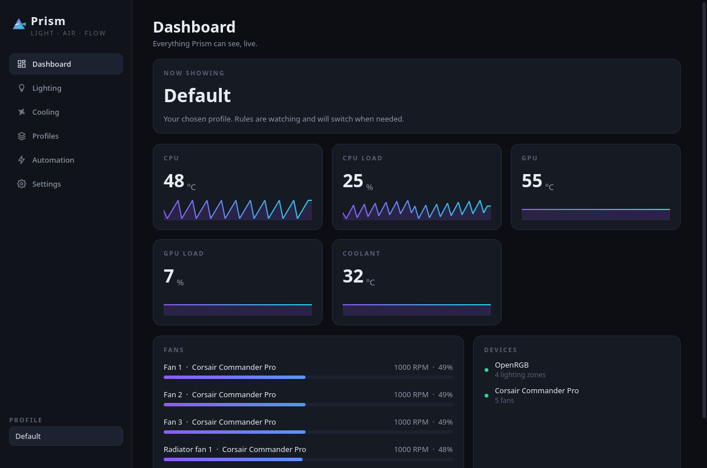
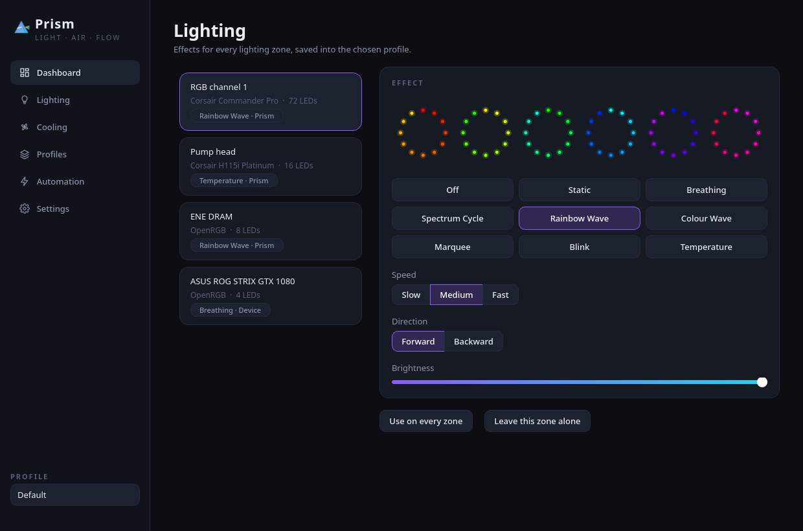
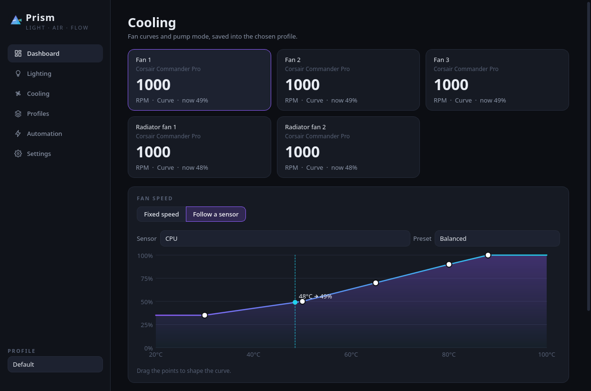

# Prism

One place on Linux to drive RGB lighting, fan speeds and cooling profiles. Prism does the job iCUE does on
Windows.



iCUE has no Linux build, and the tools that do exist each cover only part of the job. OpenRGB reaches almost
everything but resets controllers every time it detects them and can only show a still frame on a Corsair
Commander Pro. liquidctl animates the Commander Pro in hardware, but only ever lights the first fan on a hub.
Fan curves, profiles and "switch to something louder when a game starts" are not part of either.

Prism brings it together. It talks to the Commander Pro directly over USB, drives the AIO through liquidctl
and everything else through OpenRGB, and puts lighting, fan curves, profiles and rules into one window that
lives in the tray.

## Features

| Feature | What it does |
| --- | --- |
| Lighting effects | Static, Breathing, Spectrum Cycle, Rainbow Wave, Colour Wave, Marquee, Blink and Temperature, each with colours, speed, direction and brightness. |
| Hardware or drawn | Effects a device can play itself are handed to it, so they keep going after Prism closes. Everything else is drawn by Prism frame by frame, on one clock, so every device stays in step. |
| Live preview | Each zone is previewed with the same renderer the devices use. Six fans on a hub show as six rings. |
| Temperature lighting | A zone can follow any sensor: green, amber and red as the coolant warms, like the pump in iCUE. |
| Fan curves | Drag the points of a curve against any temperature, or pick Quiet, Balanced or Performance. The live reading and the duty it gives are marked on the chart. |
| Fixed speeds | Hold a fan at one duty instead. |
| Pump mode | Quiet, Balanced or Extreme for the AIO pump. |
| Profiles | Save any number of lighting and fan setups, copy them, rename them, and export or import them as files. |
| Automatic switching | Rules switch profile while a reading is high (CPU load over 80%) or a program is running (`wow.exe`), and switch back when it stops. |
| Fan safety | A floor no curve can go below, a fast failsafe speed for any fan whose sensor goes quiet, gentle ramp-downs, and a safe speed left behind when Prism exits. |
| Tray | Switch profile or pause rules from the tray without opening the window. Closing the window keeps Prism running. |
| Reconnects | A device that drops off USB is shown as offline, retried every ten seconds, and given its settings again when it returns. |





## Supported hardware

| Device | Through | What Prism drives |
| --- | --- | --- |
| Corsair Commander Pro | USB HID, directly | Both lighting channels (hardware effects over every LED, or per-LED frames) and all six fan headers. Fan speeds are read from the kernel's `corsair-cpro` driver. |
| Corsair Hydro Platinum AIO (H100i, H115i) | liquidctl | Pump head LEDs, radiator fans, pump mode and coolant temperature. |
| RAM, GPU and motherboard lighting | OpenRGB's SDK server | Any device OpenRGB supports, using its own modes or Prism's drawn frames. |
| CPU | psutil | Package temperature (Intel `coretemp`, AMD `k10temp`) and load. |
| NVIDIA GPU | `nvidia-smi` | Temperature and load. |

The Commander Pro is driven directly rather than through liquidctl because the channel has to be told about
every LED on it. liquidctl describes its effects over the first fan only, which is why a hub of six fans only
ever lit one.

## How it works

```
             ┌──────────── Prism window (Qt) ────────────┐
             │  pages send commands, redraw from state   │
             └───────────────┬────────────▲──────────────┘
                     commands│            │state
             ┌───────────────▼────────────┴──────────────┐
             │ runtime loop (own thread, 30 frames/s)    │
             │  profiles · rules · lighting · cooling    │
             └──┬──────────────┬──────────────┬──────────┘
                │              │              │
       Commander Pro      Hydro Platinum    OpenRGB server
       (hidraw + hwmon)   (liquidctl)       (RAM, GPU, board)
```

Everything that touches hardware runs on one thread of its own, so a slow USB write never freezes the
window, and nothing in the core needs a lock. Once a second Prism reads every sensor, lets the rules pick a
profile and steps each fan towards its target. Between those it draws the next lighting frame for every zone
it is drawing.

The code follows a ports and adapters layout:

| Layer | Folder | Holds |
| --- | --- | --- |
| Domain | `prism/domain` | Colours, effects and their renderers, fan curves, profiles, rules. Pure Python, no I/O. |
| Ports | `prism/ports.py` | The interfaces the services need: lighting devices, fan devices, sensors, stores. |
| Adapters | `prism/infrastructure` | The Commander Pro driver, liquidctl and OpenRGB adapters, sensors, JSON storage. |
| Services | `prism/services` | The device registry, lighting engine, cooling controller, profile library, rules and the runtime loop. |
| Window | `prism/ui` | The Qt pages and widgets, which only ever send commands and draw state. |
| Wiring | `prism/wiring.py` | The one place real adapters are chosen and handed in. |

## Things to know on this machine

- **Turn off `pump-temp-rgb.service`.** It sets the pump colour by itself and would fight Prism for the AIO.
  The Default profile's Temperature effect on the pump does the same job:
  `systemctl --user disable --now pump-temp-rgb.service`
- **Keep OpenRGB away from the Corsair devices.** When OpenRGB detects the Commander Pro or the AIO it
  resets them, and the AIO can drop off USB altogether. Settings > Hardware > *Hide them* turns those
  detectors off in OpenRGB's configuration and keeps a backup of the old file beside it.
- **Do not open the OpenRGB window while Prism runs.** It reinitialises every controller. Prism starts a
  hidden OpenRGB server on its own when it needs one.
- **Fan curves need Prism running.** The Commander Pro has no temperature probes plugged in, so Prism reads the
  sensors and sets the duty. When Prism exits it leaves every fan at the *Speed when Prism closes* setting.

## Requirements

- Linux, tested on Arch with KDE Plasma on X11
- Python 3.12 or newer
- PySide6, psutil, hidapi, liquidctl and openrgb-python
- OpenRGB, for RAM, GPU and motherboard lighting
- Read and write access to the Commander Pro's hidraw node and the AIO, which the OpenRGB and liquidctl udev
  rules already give the logged-in user

## Install

```sh
pipx install --system-site-packages --editable ~/Projects/Prism
install -Dm644 ~/Projects/Prism/prism/ui/assets/prism.svg ~/.local/share/icons/hicolor/scalable/apps/prism.svg
install -Dm644 ~/Projects/Prism/packaging/prism.desktop ~/.local/share/applications/prism.desktop
```

Then start **Prism** from the application launcher, or run `prism`. To start it at login, switch on
Settings > General > *Start at login*. `prism --hidden` starts straight into the tray, and `prism --debug`
logs device traffic to the terminal as well as the log file.

Launching Prism while it is already running brings the existing window forward instead of starting a second
copy, since two copies would fight over the same devices.

## Files

| File | Holds |
| --- | --- |
| `~/.config/prism/profiles.json` | Saved profiles |
| `~/.config/prism/rules.json` | Automation rules, highest priority first |
| `~/.config/prism/settings.json` | Settings |
| `~/.local/state/prism/prism.log` | The log, rotated at 1 MB |

Files are written atomically. A file that cannot be read is renamed to `.damaged` rather than overwritten.

## Development

```sh
python -m venv --system-site-packages .venv
.venv/bin/pip install -e '.[dev]'
QT_QPA_PLATFORM=offscreen .venv/bin/python -m pytest --cov
.venv/bin/ruff check prism tests && .venv/bin/ruff format --check prism tests
.venv/bin/mypy
```

The tests drive every service against in-memory fakes of the devices, so none of them need hardware. The
Commander Pro tests check the exact bytes sent for each effect and frame.

## Licence

MIT. See [LICENSE](LICENSE).
